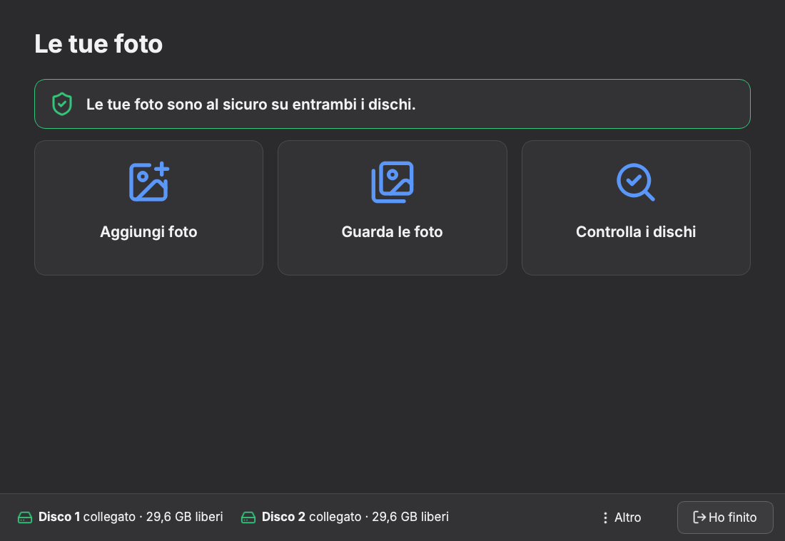
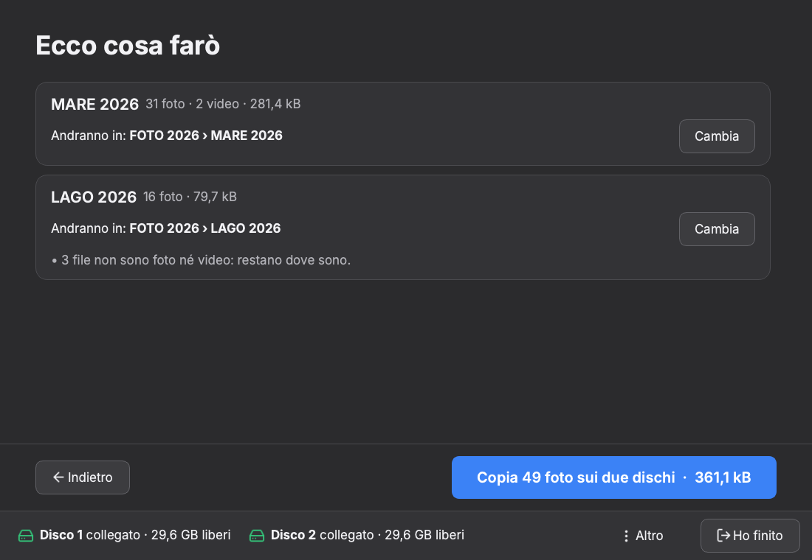
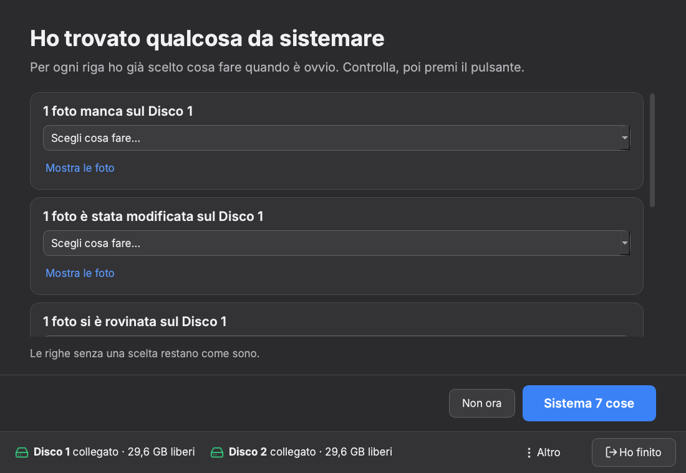
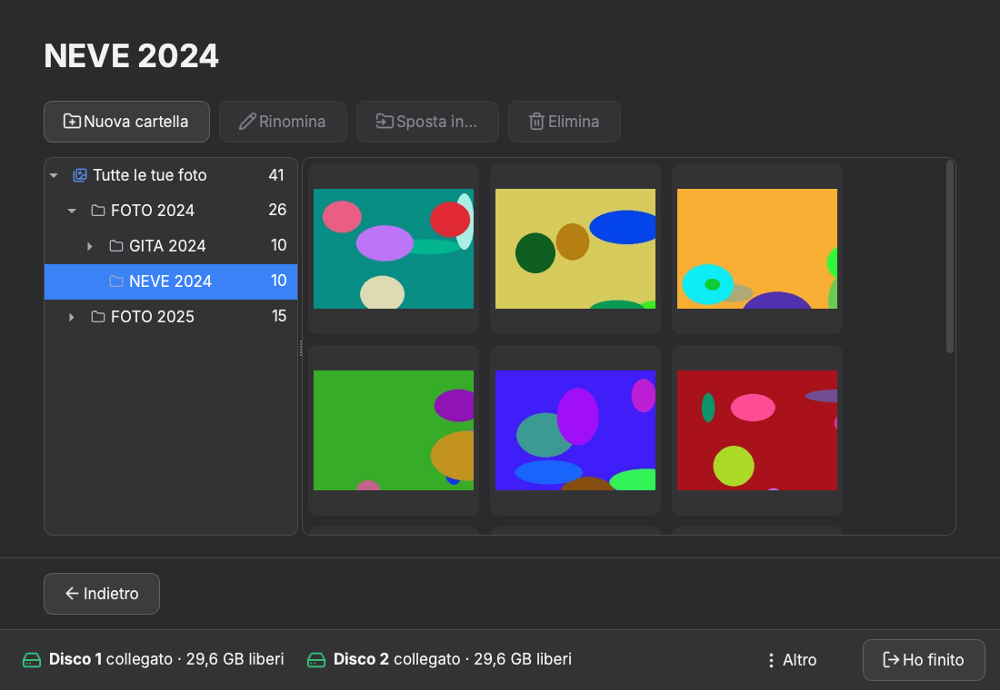
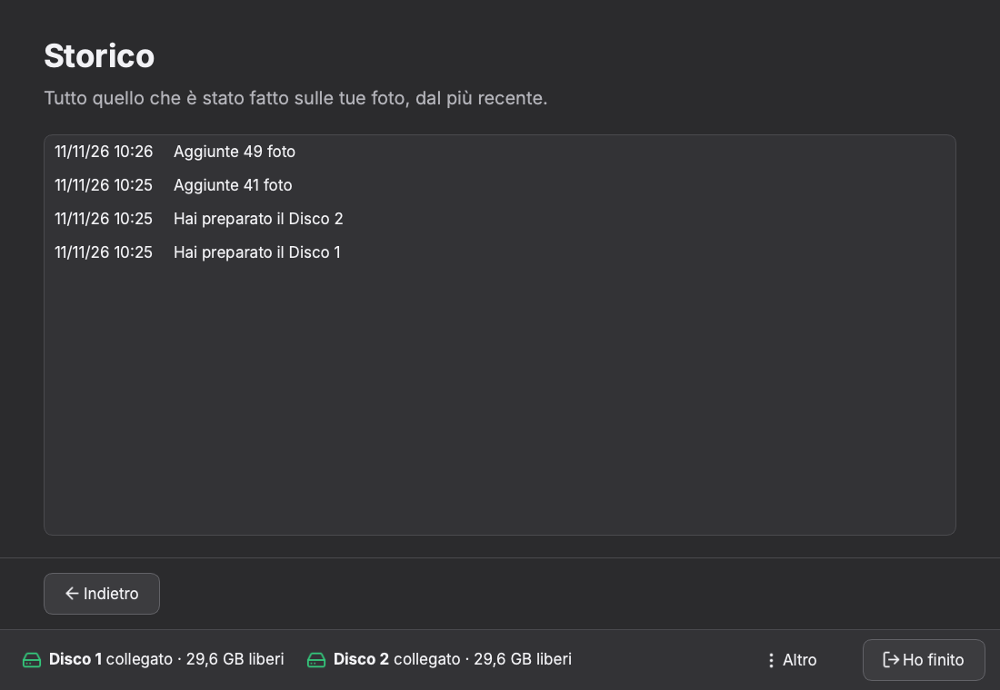

# PhotoSaver

[](https://github.com/GiacomoGuaresi/PhotoSaver/actions/workflows/ci.yml)
[](LICENSE)

[English](README.md) · **Italiano**

Un'app desktop che tiene un archivio di foto **in mirror su due dischi
esterni**, come un RAID 1 ma gestito dall'app: i due dischi restano normali
dischi exFAT, leggibili su qualsiasi computer anche senza l'app.

Pensata per chi usa pochissimo il computer: pulsanti grandi, una cosa alla
volta, nessuna parola tecnica, italiano e inglese.



## Cosa fa

- **Carica** cartelle di foto e video su entrambi i dischi in una volta sola,
  verificando ogni copia con un checksum.
- **Controlla** che i due dischi contengano gli stessi file, riconosce la
  corruzione silenziosa (bit rot) e i file mancanti, spostati o cancellati, e
  li sistema partendo dalla copia buona.
- **Tiene traccia delle modifiche**, anche di quelle fatte fuori dall'app, con
  uno storico completo e un cestino dell'app.
- **Mostra** l'archivio con miniature, anteprima a tutto schermo e stato di
  sincronizzazione di ogni file.

| Anteprima del caricamento | Risultati del controllo |
|---|---|
|  |  |

| Visualizzatore | Storico |
|---|---|
|  |  |

Le schermate sono prese su dischi simulati con immagini generate
(`scripts/screenshots.py`).

## Stato

**Alpha funzionante (v0.4.1), in uso reale.** La avvio da sorgente per tenere
il mio archivio di foto su due dischi. Non c'è ancora un programma di
installazione.

Funziona oggi:

- il motore: identità dei dischi, indice, copia verificata, caricamento,
  controllo veloce e completo, riconoscimento degli spostamenti, riparazione,
  cestino, ripresa delle operazioni interrotte;
- tutta l'interfaccia: collegamento e preparazione dei dischi, aggiunta delle
  foto, controllo, storico, cestino, visualizzatore con rinomina, spostamento e
  cancellazione su entrambi i dischi;
- riconoscimento automatico dei dischi collegati e rimozione sicura.

Manca ancora (vedi la [roadmap](doc/roadmap.md)):

- la formattazione exFAT dall'app: i dischi devono essere già formattati;
- la procedura guidata per sostituire un disco guasto;
- i promemoria per il controllo completo;
- i pacchetti pronti per Windows e Linux.

## Provarla

Serve [uv](https://docs.astral.sh/uv/). Questi comandi avviano l'app su due
dischi simulati (semplici cartelle), senza toccare nessun disco vero:

```sh
git clone https://github.com/GiacomoGuaresi/PhotoSaver.git
cd PhotoSaver
uv run python scripts/dev_disks.py setup      # foto finte, un archivio su due cartelle
uv run python -m photosaver --disks dev-disks/disk-a dev-disks/disk-b
uv run python scripts/dev_disks.py break all  # poi "Controlla i dischi" nell'app
```

Senza `--disks` l'app cerca l'archivio sui dischi esterni collegati.

## Come tiene al sicuro le foto

- **Copia verificata.** Ogni file viene scritto con un nome temporaneo,
  scaricato sul disco, riletto e confrontato con lo SHA-256 dell'originale;
  solo allora prende il nome definitivo. L'originale viene letto una volta sola
  per entrambi i dischi. Un file esistente non viene mai sovrascritto, e
  un'interruzione lascia al massimo un file temporaneo che la copia successiva
  sostituisce.
- **Un indice su ogni disco.** Un database SQLite, identico sui due dischi,
  registra dimensione, data e SHA-256 di ogni file e lo stato di ogni copia.
  Gli hash si possono verificare anche senza l'app (`sha256sum`, `certutil`).
- **Controllo veloce** (secondi): confronta dimensione e data di ogni file con
  l'indice e calcola l'hash solo dei file che sembrano diversi.
- **Controllo completo** (ore su un archivio grande): legge ogni file su
  entrambi i dischi in parallelo e ne confronta l'hash con l'indice. Contenuto
  diverso con la stessa data significa **bit rot**; contenuto e data diversi
  significano che il file è stato modificato fuori dall'app. Riprende dopo
  un'interruzione.
- **Ripara proponendo, non da sola.** I controlli non modificano mai i file.
  Nei casi ovvi (una copia rovinata e una buona, un file che manca su un disco
  che non l'ha mai avuto) la soluzione è già selezionata; in quelli ambigui
  (cancellato apposta, o perso?) l'app chiede.
- **Niente viene distrutto.** I file sostituiti o cancellati dall'app finiscono
  in un cestino sullo stesso disco e si possono ripristinare.
- **Operazioni interrotte.** Riparazioni e modifiche (rinomina, spostamento,
  cancellazione) vengono scritte in un journal prima di cominciare, così dopo
  un blocco o un cavo staccato vengono riconosciute e completate. Un
  caricamento interrotto si rilancia e basta: i file già copiati vengono
  riconosciuti e saltati.

Il motore non dipende da Qt ed è coperto da 320 test, compresi gli scenari di
guasto (interruzione, file rovinato, disco mancante). Un job separato della CI
lo esegue su due volumi exFAT veri, per coprire ciò che le cartelle non possono
simulare: maiuscole e minuscole e precisione delle date. Formato dei dati sui
dischi: [doc/formato-dati.md](doc/formato-dati.md).

## Limiti noti

- **Due dischi, entrambi collegati.** Con un disco solo l'archivio è in sola
  lettura.
- **Si avvia da sorgente.** Niente programma di installazione né aggiornamenti
  automatici.
- **Piattaforme.** La CI gira su Linux e Windows. Da sorgente funziona anche su
  macOS, che non è ancora nella CI.
- **Rilettura dalla cache.** Prima di rileggere la copia, l'app chiede al
  sistema di svuotare la cache; solo Linux lo permette, quindi altrove una
  copia appena fatta può essere verificata dalla memoria. Il controllo
  completo, fatto più tardi, legge sempre il disco.
- **È un mirror, non una strategia di backup.** Due dischi tenuti nella stessa
  casa non proteggono da furto o incendio.

## PhotoSaver e HddRaid

[HddRaid](https://github.com/GiacomoGuaresi/HddRaid) è la versione ridotta
della stessa idea, scritta in Rust: file di qualsiasi tipo si copiano a mano su
uno dei due dischi e l'app si limita ad allinearli. In PhotoSaver le foto
entrano dall'app, che aggiunge caricamento verificato, storico e
visualizzatore.

## Com'è fatta

Python 3.11+, PySide6 (Qt), SQLite, Pillow; uv, pytest e ruff. La logica sta in
`src/photosaver/core/`, l'interfaccia in `src/photosaver/ui/` si limita a
chiamarla. I documenti di progetto sono in [`doc/`](doc/README.md): obiettivo,
flussi, formato dei dati, roadmap, guida allo sviluppo.

Scritta con un assistente di programmazione IA (Claude Code), a piccoli passi
di un commit ciascuno. Ho deciso io cosa fa e come sono salvati i dati, e ho
letto ogni modifica prima che entrasse.

## Licenza

[MIT](LICENSE)
