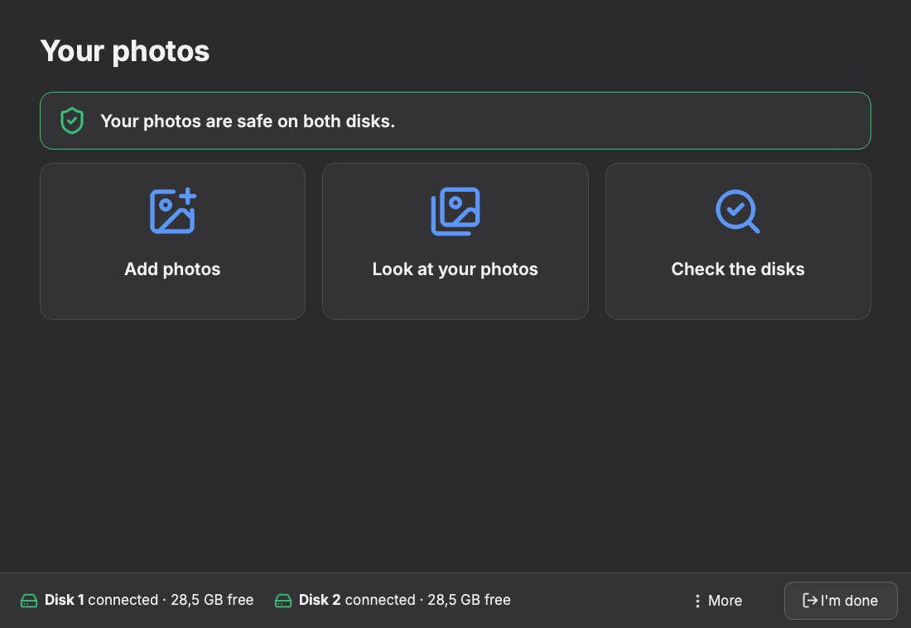
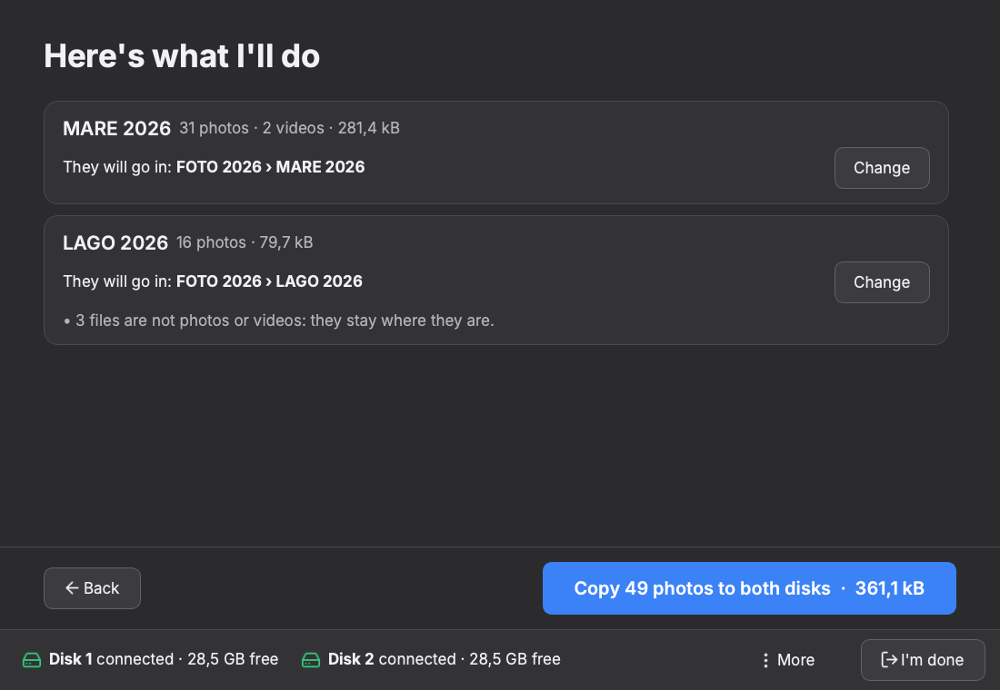
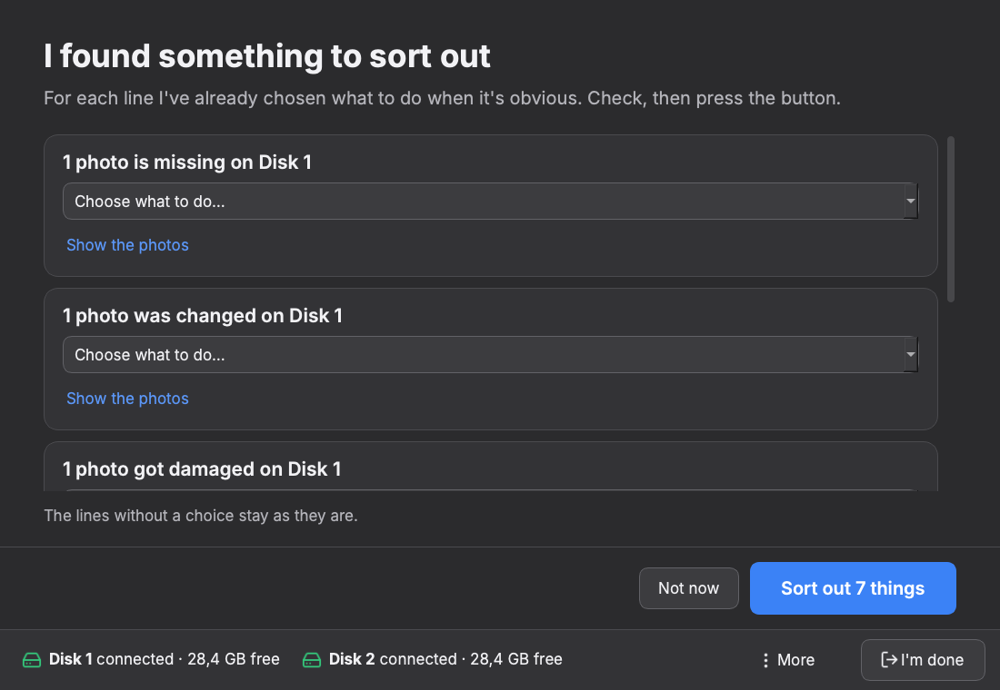
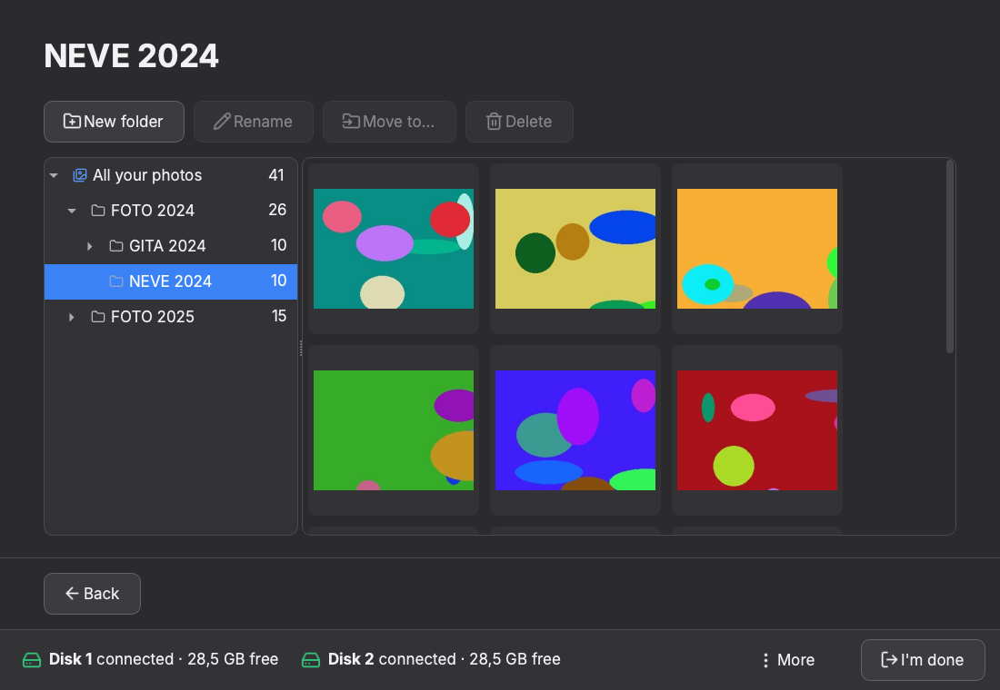
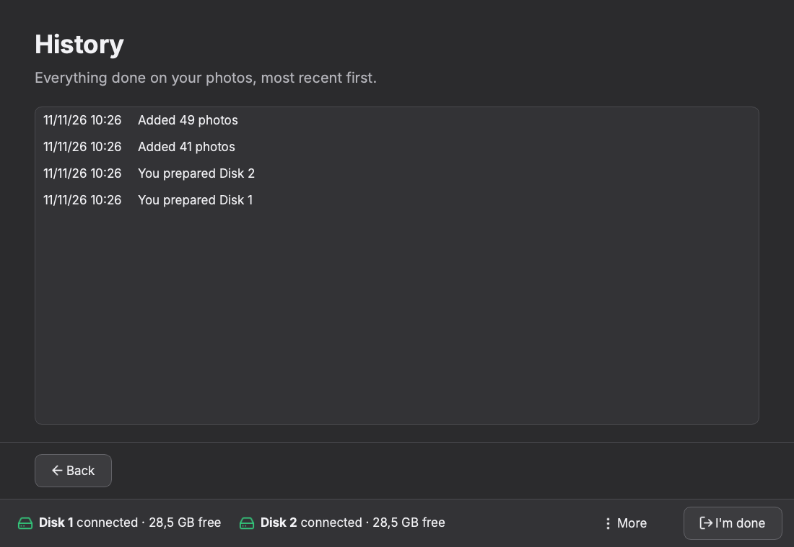

# PhotoSaver

[](https://github.com/GiacomoGuaresi/PhotoSaver/actions/workflows/ci.yml)
[](LICENSE)

**English** · [Italiano](README.it.md)

A desktop app that keeps a photo archive **mirrored on two external drives**,
like RAID 1 but at application level: both drives stay plain exFAT disks,
readable on any computer even without the app.

Made for people who barely use a computer: big buttons, one step at a time, no
technical words, Italian and English.



## What it does

- **Upload** folders of photos and videos to both drives in one go, with
  every copy verified by checksum.
- **Check** that the two drives hold the same files, detect silent corruption
  (bit rot), missing, moved or deleted files, and fix them from the good copy.
- **Track changes**, also those made outside the app, with a full history and
  an app-level trash.
- **Browse** the archive with thumbnails, full-screen preview and per-file sync
  status.

| Upload preview | Check results |
|---|---|
|  |  |

| Viewer | History |
|---|---|
|  |  |

The screenshots are taken on simulated disks with generated pictures
(`scripts/screenshots.py`).

## Status

**Working alpha (v0.4.1), in real use.** I run it from source to keep my own
photo archive on two drives. There is no installer yet.

Works today:

- the engine: disk identity, index, verified copy, upload, quick and full
  check, move detection, repair, trash, recovery of interrupted operations;
- the whole interface: connect and prepare the disks, add photos, check,
  history, trash, viewer with rename, move and delete on both drives;
- automatic detection of connected drives and safe eject.

Still missing (see the [roadmap](doc/roadmap.md), in Italian):

- exFAT formatting from the app: the drives must already be formatted;
- a guided "replace a broken drive" procedure;
- reminders for the full check;
- packaged builds for Windows and Linux.

## Try it

You need [uv](https://docs.astral.sh/uv/). These commands run the app on two
simulated disks (plain folders), without touching any real drive:

```sh
git clone https://github.com/GiacomoGuaresi/PhotoSaver.git
cd PhotoSaver
uv run python scripts/dev_disks.py setup      # fake photos, an archive on two folders
uv run python -m photosaver --disks dev-disks/disk-a dev-disks/disk-b
uv run python scripts/dev_disks.py break all  # then "Check the disks" in the app
```

Without `--disks` the app looks for the archive on the connected external
drives.

## How it keeps the photos safe

- **Verified copy.** Each file is written under a temporary name, flushed to
  the disk, read back and compared with the SHA-256 of the source; only then it
  gets its final name. The source is read once for both drives. An existing
  file is never overwritten, and an interruption leaves at most a temporary
  file that the next copy replaces.
- **An index on each drive.** A SQLite database, identical on the two drives,
  records size, date and SHA-256 of every file and the state of each copy. The
  hashes can be checked without the app (`sha256sum`, `certutil`).
- **Quick check** (seconds): compares size and date of every file with the
  index and hashes only the files that look different.
- **Full check** (hours on a big archive): reads every file on both drives in
  parallel and compares its hash with the index. Different content with the
  same date means **bit rot**; different content and date means the file was
  edited outside the app. It resumes after an interruption.
- **Repair with a proposal, not on its own.** Checks never change files. For
  the obvious cases (a damaged copy and a good one, a file missing from a drive
  that never had it) the fix is already selected; for the ambiguous ones
  (deleted on purpose, or lost?) the app asks.
- **Nothing is destroyed.** Files replaced or deleted by the app go to a trash
  on the same drive and can be restored.
- **Interrupted operations.** Repairs and edits (rename, move, delete) are
  written in a journal before they start, so after a crash or an unplugged
  cable they are recognised and completed. An interrupted upload is simply run
  again: the files already copied are recognised and skipped.

The engine has no Qt dependency and is covered by 320 tests, including failure
scenarios (interruption, damaged file, missing drive). A separate CI job runs
it on two real exFAT volumes, to cover what folders cannot simulate: letter
case and date precision. On-disk format: [doc/formato-dati.md](doc/formato-dati.md)
(in Italian).

## Known limits

- **Two drives, both connected.** With one drive the archive is read-only.
- **Run from source.** No installer and no automatic updates.
- **Platforms.** CI runs on Linux and Windows. It also runs from source on
  macOS, which is not in CI yet.
- **Read-back from the page cache.** The copy asks the system to drop its
  cache before the read-back; only Linux supports this, so elsewhere a fresh
  copy may be verified from memory. The full check, done later, always reads
  the disk.
- **It is a mirror, not a backup strategy.** Two drives kept in the same house
  do not protect from theft or fire.

## PhotoSaver and HddRaid

[HddRaid](https://github.com/GiacomoGuaresi/HddRaid) is the reduced version of
the same idea, written in Rust: files of any kind are copied by hand to either
drive and the app only aligns the two. In PhotoSaver the photos go in through
the app, which adds verified upload, history and the viewer.

## How it is built

Python 3.11+, PySide6 (Qt), SQLite, Pillow; uv, pytest and ruff. The logic
lives in `src/photosaver/core/`, the interface in `src/photosaver/ui/` only
calls it. Design documents are in [`doc/`](doc/README.md) (in Italian): goal,
flows, data format, roadmap, development guide.

Written with an AI coding assistant (Claude Code), in small steps of one commit
each. I decided what it does and how the data is stored, and I read every
change before it went in.

## License

[MIT](LICENSE)
